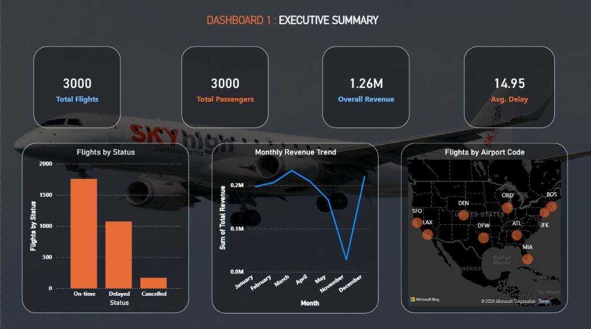
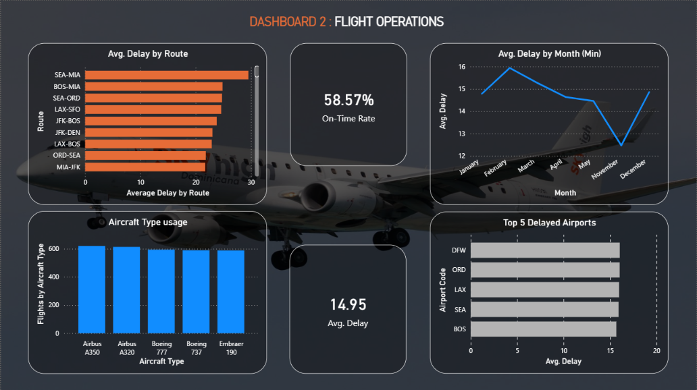
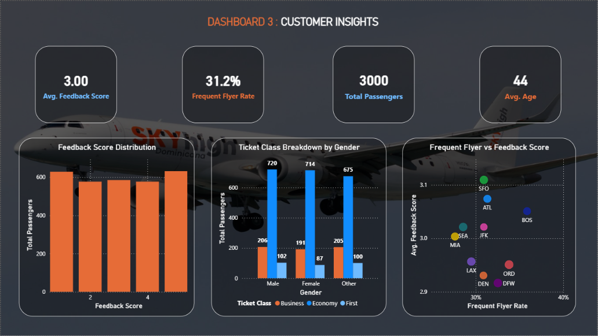

# Screenshots

Screenshots of the three report pages.

## Dashboard 1 – Executive Summary

KPI cards, Flights by Status, Monthly Revenue Trend and a map of flights by airport.

## Dashboard 2 – Flight Operations

Average delay by route, Average delay by month, Aircraft type usage, Top 5 delayed airports, On-Time Rate and Avg. Delay(KPI cards).

## Dashboard 3 – Customer Insights

KPI cards, feedback score distribution, ticket class by gender and frequent flyers vs satisfaction score.
