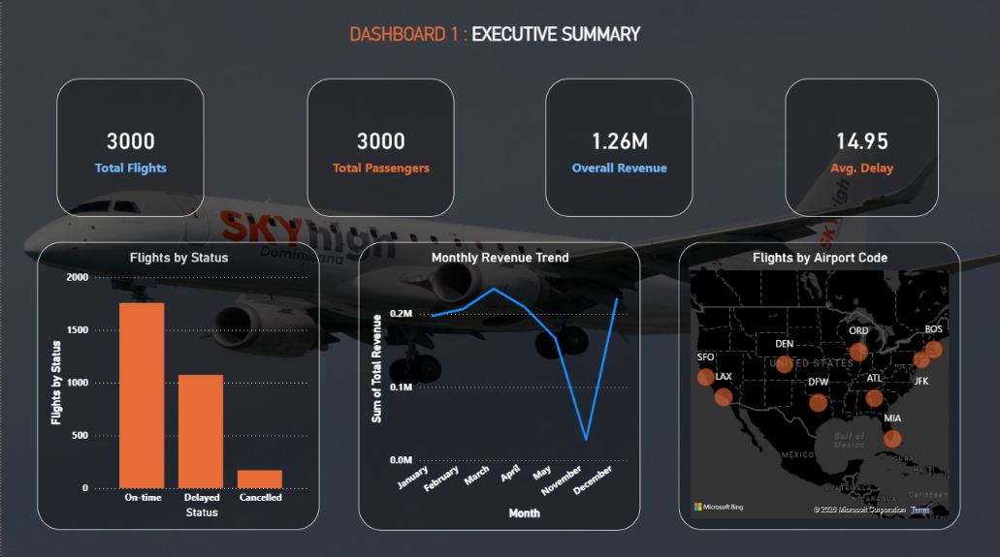
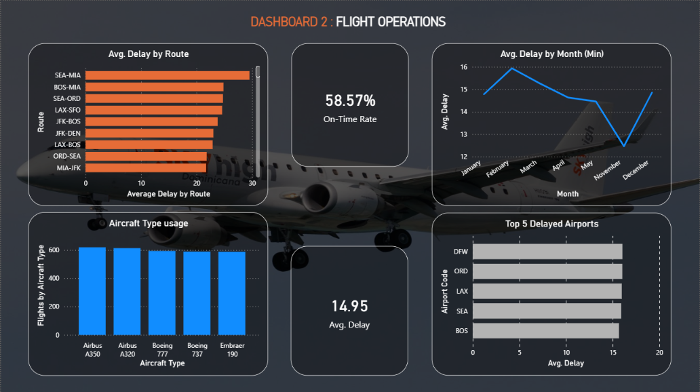
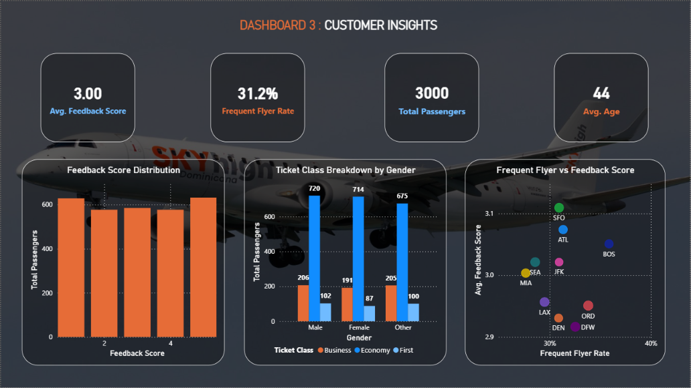

# SkyHigh Airlines – Power BI Flight Performance Dashboard

An interactive Power BI report that analyses flights, delays, passenger satisfaction and revenue for SkyHigh Airlines.

## Project background

SkyHigh Airlines is a mid-sized international airline. Management wanted to improve operational efficiency and customer satisfaction, and asked for a dashboard to analyse flights, delays, passenger satisfaction and revenue trends.

## Objectives

- Analyse overall airline performance
- Track flight punctuality and identify delay trends
- Evaluate passenger satisfaction scores
- Understand top-performing routes and airports
- Provide KPIs to help decision-makers plan improvements

## Dashboards

### Dashboard 1 – Executive Summary



- KPI cards: Total Flights, Total Passengers, Total Revenue, Average Delay
- Flights by Status
- Monthly Revenue Trend
- Map of flights by airport (bubble size = number of flights)

### Dashboard 2 – Flight Operations



- On-Time Rate and Average Delay cards
- Average Delay by Route
- Delay Trend by Month
- Aircraft Type Usage
- Top 5 Delayed Airports

### Dashboard 3 – Customer Insights



- Average Feedback Score, Frequent Flyer Rate, Total Passengers, Average Age
- Feedback Score Distribution
- Ticket Class Breakdown by Gender
- Frequent Flyers vs Satisfaction (scatter plot by airport)

## Key KPIs

| KPI                    | Value     |
| ---------------------- | --------- |
| Total Flights          | 3,000     |
| Total Passengers       | 3,000     |
| Total Revenue          | 1,261,785 |
| On-Time Rate           | 58.57%    |
| Average Delay          | 14.95 min |
| Average Feedback Score | 3.00 / 5  |
| Frequent Flyer Rate    | 31.2%     |

## Key insights

- **Punctuality:** 1,757 flights (58.57%) were on time, 1,073 (35.77%) were delayed and 170 (5.67%) were cancelled.
- **Worst routes:** SEA-MIA has the highest average delay (29.5 min), followed by BOS-MIA (24.8) and SEA-ORD (24.8).
- **Top 5 delayed airports (departure):** DFW 16.04, ORD 16.03, LAX 15.97, SEA 15.92, BOS 15.67 min. The gaps are small, so delay is spread across airports.
- **Delay trend:** average delay is highest in February (15.9 min) and lowest in November (12.5 min).
- **Revenue:** March is the strongest month (234,255), followed by December (220,010).
- **Fleet usage:** the five aircraft types are used almost equally (587 to 619 flights each).
- **Satisfaction:** the average score is 3.00 out of 5. Scores are spread evenly from 1 to 5, with slightly more 1s and 5s than the middle scores.
- **Ticket class:** Economy 70.3%, Business 20.1%, First 9.6%. Business has the lowest average feedback (2.91).
- **Frequent flyers (31.2%)** give the same average score (3.00) as other passengers, so loyalty status does not show a link with satisfaction.
- **Airports by satisfaction:** SFO is highest (3.11) and DFW is lowest (2.92).

## Recommendations

1. Review schedules and turnaround on SEA-MIA, BOS-MIA and SEA-ORD, the three routes with the longest delays.
2. Investigate cancelled flights, which are 5.67% of all flights.
3. Look at the Business class experience, which scores lowest on satisfaction.
4. Review the frequent flyer programme, since it does not lift satisfaction.
5. Add data for the missing months (June to October) so trends can be read for a full year.

## DAX measures

The six required measures are Total Flights, On-Time Rate, Avg. Delay, Overall Revenue, Avg. Feedback Score and Frequent Flyer Rate. Full formulas are in [`docs/DAX_Measures.md`](docs/DAX_Measures.md).

## Dataset

| File                       | Content                                                                                     |
| -------------------------- | ------------------------------------------------------------------------------------------- |
| `Airline_Flights.csv`    | Flight ID, airline, source and destination, times, status, delay (min), aircraft type, date |
| `Airline_Passengers.csv` | Passenger details, ticket class, age, gender, feedback score, frequent flyer (Y/N)          |
| `Airline_Revenue.csv`    | Revenue per flight                                                                          |
| `Airline_Airports.csv`   | Airport code, city, country, region                                                         |

Data notes:

- The flights file contains five airlines. The report analyses the full dataset (3,000 flights).
- Cancelled flights carry delay minutes (90 to 120), which are included in Average Delay.
- Flights exist only for January to May, November and December, so November looks low.
- The `On-Time %` column in the airports file is not used; on-time rate is calculated from the flights data.

## Tools used

- Microsoft Power BI Desktop (DAX, Power Query)
- MS Excel (CSV data files)

## How to open

1. Install [Power BI Desktop](https://powerbi.microsoft.com/desktop/) (free, Windows).
2. Download `dashboards/SkyHigh_Airline_Report.pbix`.
3. Open it in Power BI Desktop. If asked, refresh or point the data source to the CSV files in the `data` folder.

## Repository structure

```
skyhigh-airlines-powerbi-dashboard/
├── README.md
├── .gitignore
├── dashboards/
│   └── SkyHigh_Airline_Report.pbix
├── data/
│   ├── Airline_Airports.csv
│   ├── Airline_Flights.csv
│   ├── Airline_Passengers.csv
│   └── Airline_Revenue.csv
├── docs/
│   ├── Project_Requirements.docx
│   └── DAX_Measures.md
└── images/
    ├── dashboard1_executive_summary.png
    ├── dashboard2_flight_operations.png
    └── dashboard3_customer_insights.png
```

## Author

**[GUNASOORIYA G S]**
[LinkedIn:https://www.linkedin.com/in/gunasooriya] | [Email:gunasooriyacseengineer@gmail.com]
